<p align="center">
  
</p>

<h3 align="center">Armalo a tu manera.</h3>

<p align="center">
  Cotizador y sistema de reservas online de viajes grupales e individuales,<br>
  con web para clientes y panel de administración para la agencia.
</p>

<p align="center">
  
  
  
  
  
  
</p>

<p align="center">
  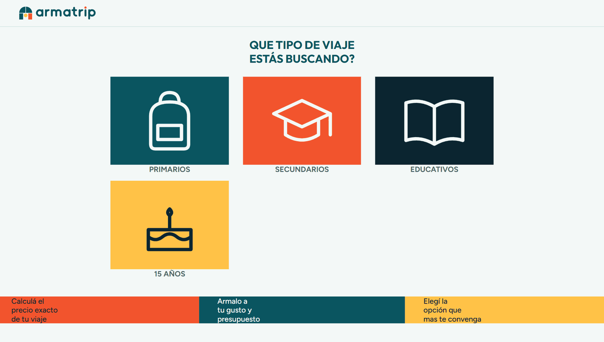
</p>

## Contenido

[Qué resuelve](#qué-resuelve) · [Web del cliente](#web-del-cliente) · [Panel](#panel-de-administración) · [Arquitectura](#arquitectura) · [Puesta en marcha](#puesta-en-marcha) · [Configuración](#configuración) · [Documentación](#documentación) · [Estado](#estado-del-proyecto)

## Qué resuelve

Cotizar un viaje grupal suele implicar llamados, planillas y presupuestos que se rehacen una y otra vez. Con Armatrip, el grupo elige destino, fecha y servicios, **ve el precio por pasajero y la cuota al instante** y genera la reserva. La agencia administra catálogo, precios y reservas desde un único panel.

| Para el cliente | Para la agencia |
|---|---|
| Cotización online, sin esperas | Catálogo de paquetes, servicios y grupos |
| Servicios a elección con precio en vivo | Reglas de precio por fecha, provincia y cuotas |
| Verificación del celular por código | Reservas con filtros, edición y exportación |
| Cupones de descuento | Cupones y usuarios beneficiados |
| Seña opcional con Mercado Pago | Configuración de pagos y avisos por email |
| Cotización para compartir | Varias empresas o segmentos con imagen propia |
| Uso desde el celular e instalación como app | Roles y permisos por pantalla |

## Web del cliente

### 1. Elegir el destino

Cada tipo de viaje muestra sus destinos y paquetes disponibles.

<p align="center">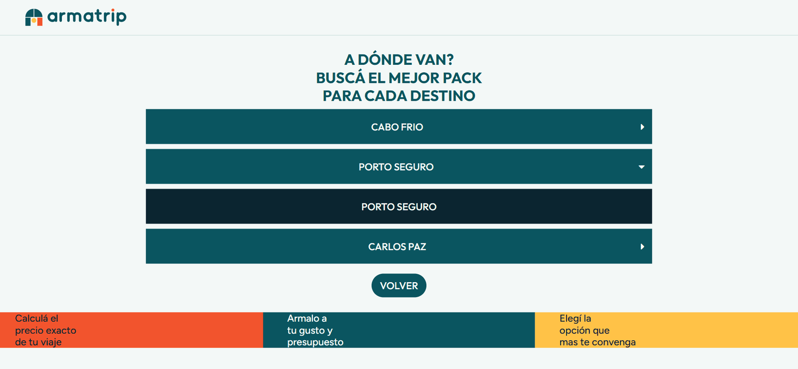</p>

### 2. Contar quiénes viajan y cuándo

Origen, colegio, cantidad de pasajeros y fechas habilitadas para el paquete.

<p align="center">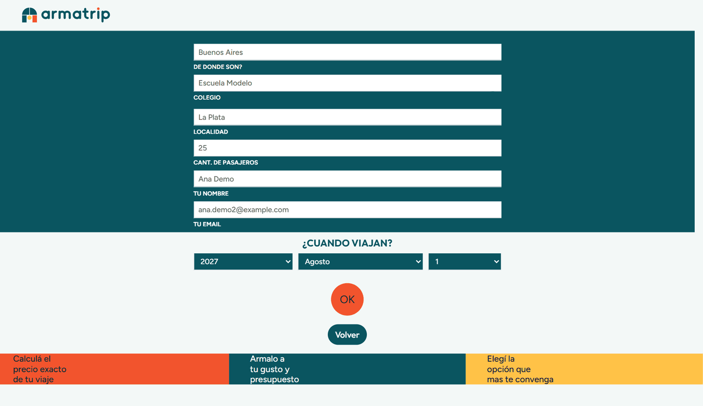</p>

### 3. Validar el celular

Un código de un solo uso confirma la identidad. Vence a los 10 minutos y limita los intentos.

<p align="center">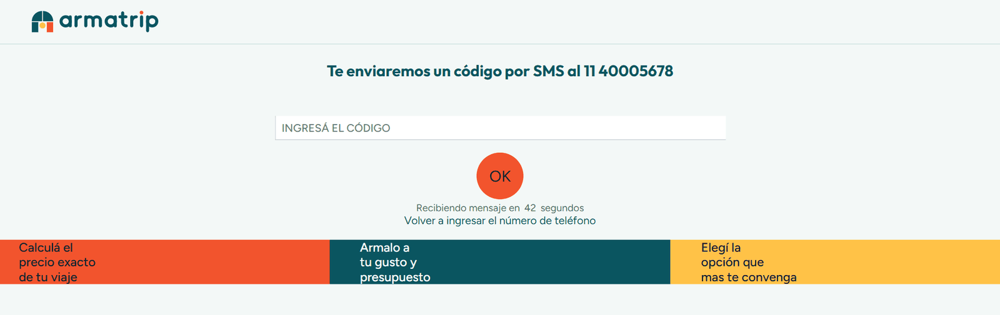</p>

### 4. Armar el paquete

Transporte, hotel y excursiones a elección, con el valor de la cuota y del pasajero.

<table>
  <tr>
    <td width="50%">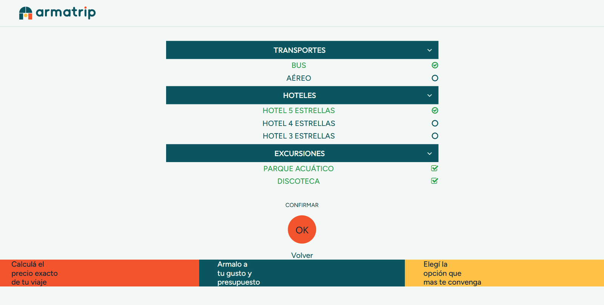</td>
    <td width="50%">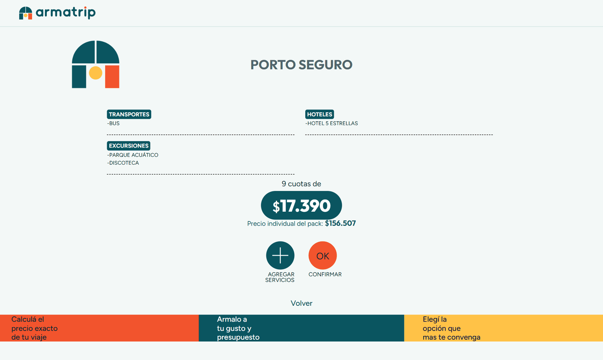</td>
  </tr>
  <tr>
    <td align="center">Servicios por categoría</td>
    <td align="center">Resumen y precio</td>
  </tr>
</table>

### 5. Reservar y compartir

Al confirmar, la reserva queda registrada y salen los emails al cliente y a la agencia. Si los pagos están habilitados, se puede abonar una seña con Mercado Pago.

<p align="center">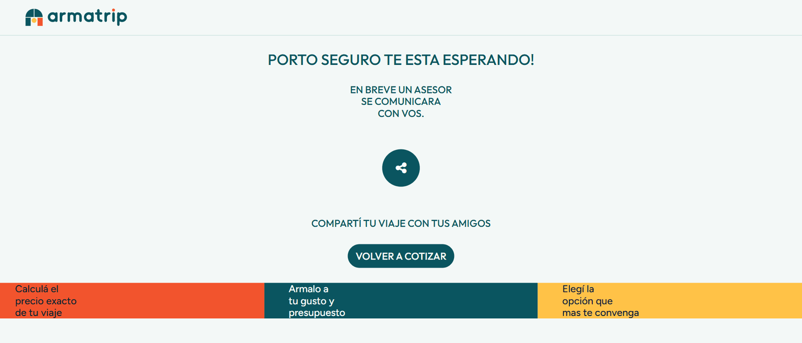</p>

### Turismo individual

El mismo motor con recorrido propio y fechas concretas.

<p align="center">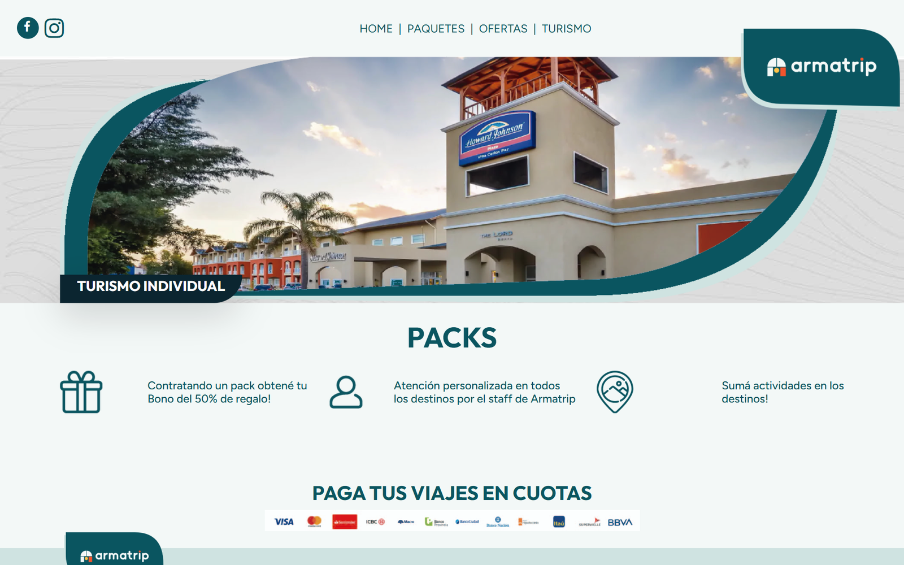</p>

### En el celular

<p align="center">
  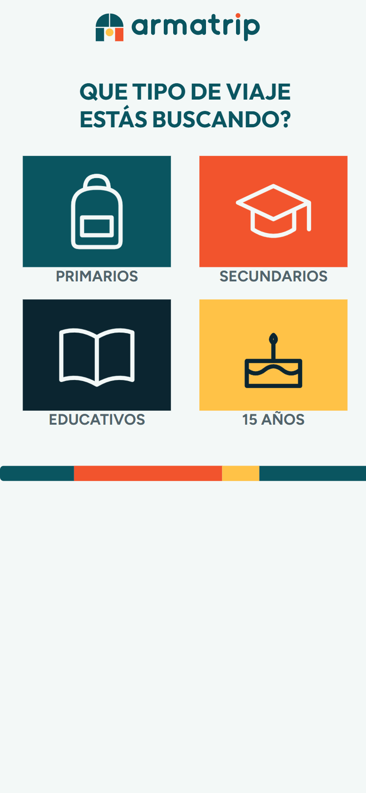
  &nbsp;&nbsp;&nbsp;
  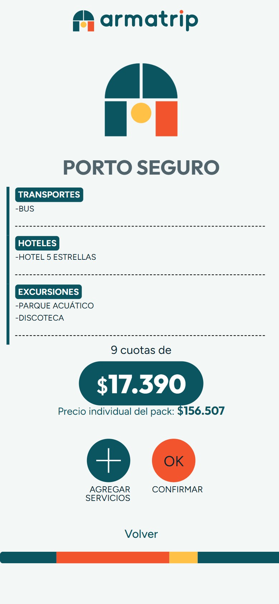
</p>

## Panel de administración

<p align="center">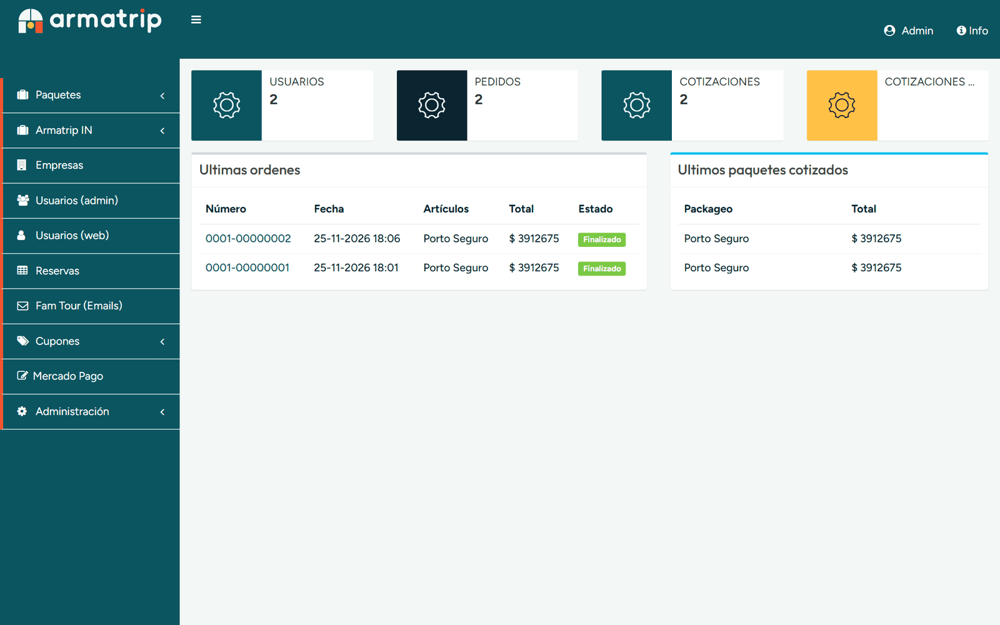</p>

<table>
  <tr>
    <td width="50%">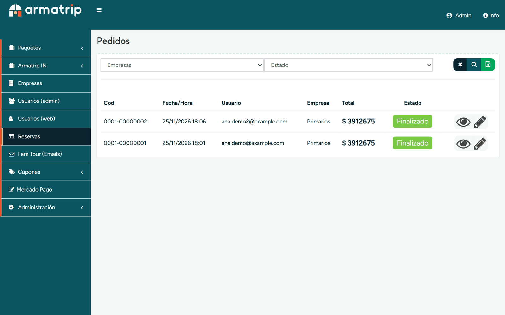</td>
    <td width="50%">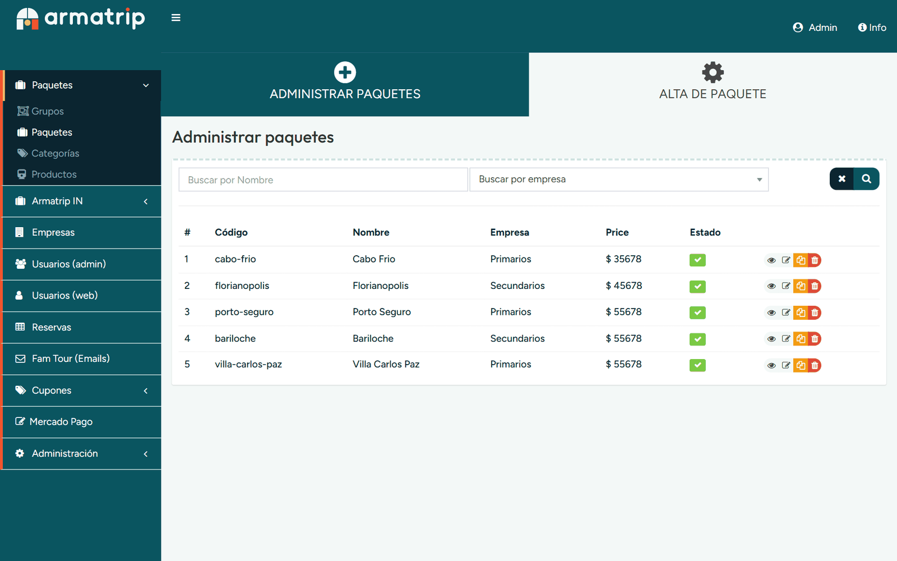</td>
  </tr>
  <tr>
    <td align="center"><b>Reservas:</b> filtros, edición, impresión y exportación</td>
    <td align="center"><b>Paquetes:</b> clonado, simulación de precio, fechas y fotos</td>
  </tr>
  <tr>
    <td>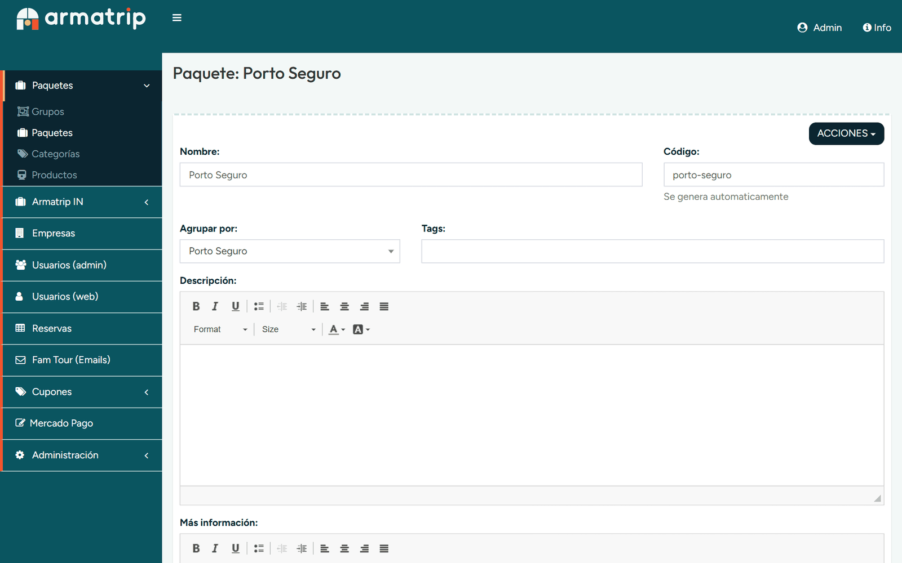</td>
    <td>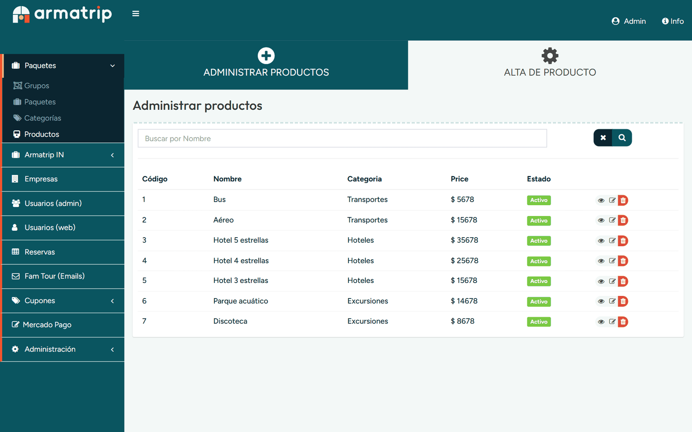</td>
  </tr>
  <tr>
    <td align="center"><b>Edición</b> de contenido y condiciones</td>
    <td align="center"><b>Servicios</b> por categoría y precio</td>
  </tr>
  <tr>
    <td>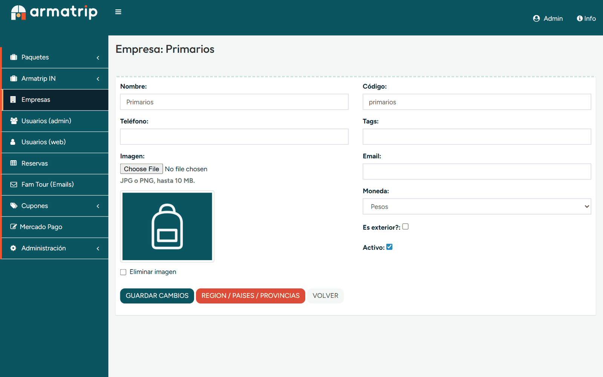</td>
    <td>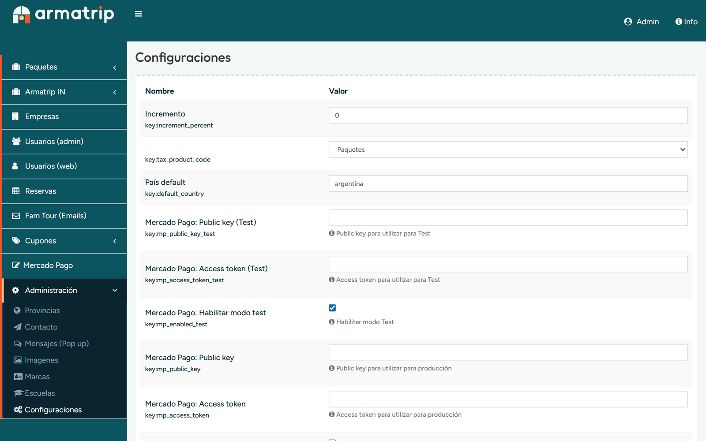</td>
  </tr>
  <tr>
    <td align="center"><b>Empresas</b> con imagen, moneda y provincias</td>
    <td align="center"><b>Configuración</b> general y de pagos</td>
  </tr>
</table>

También incluye cupones, marcas, escuelas, mensajes emergentes, contactos, usuarios y permisos.

> Las capturas usan datos ficticios de una base de demostración.

## Arquitectura

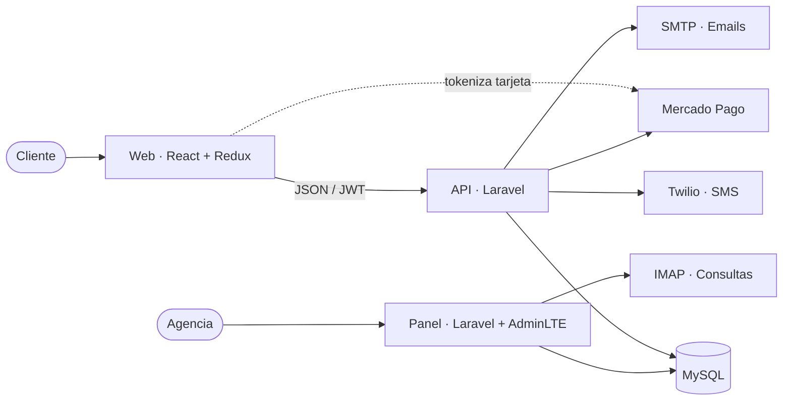

| Carpeta | Contenido |
|---|---|
| `frontend/` | Cotizador web instalable (PWA) |
| `backend/` | API REST y panel de administración |
| `docker/` | Preparación del entorno local |
| `docs/` | Documentación técnica, marca y capturas |

### Cómo se calcula el precio

El precio por pasajero se obtiene en este orden:

1. Base del paquete más su incremento.
2. Servicios elegidos; la provincia de origen puede recargar el transporte.
3. Recargo del paquete por cantidad de cuotas.
4. Incremento global.
5. Recargo del rango de fechas.
6. Descuento del cupón.

**Total** = precio por pasajero × pasajeros. **Cuota** = precio por pasajero ÷ cuotas, limitadas por los meses que faltan para el viaje.

### Conceptos

| Término | Significado |
|---|---|
| **Empresa** | Segmento de negocio: primarios, secundarios, educativos, 15 años |
| **Grupo** | Agrupa paquetes, normalmente por destino; debe estar activo para que se vean |
| **Paquete** | Viaje en venta, con precio base, cuotas, fotos y videos |
| **Servicio** | Componente del paquete: transporte, hotel o excursión |
| **Rango de fechas** | Disponibilidad con recargo propio |
| **Orden** | Cotización pendiente que, al confirmarse, se convierte en reserva |

## Puesta en marcha

Requiere Docker Desktop y, para preparar el entorno, PowerShell.

```powershell
git clone git@github.com:rspirolazzi/armatrip.git
```

```powershell
cd armatrip
```

```powershell
powershell -ExecutionPolicy Bypass -File docker/preparar-entorno.ps1
```

```powershell
docker compose up -d --build
```

El primer inicio crea la base y carga datos de ejemplo.

| Servicio | Dirección |
|---|---|
| Web | http://localhost:3085 |
| Panel | http://localhost:8085/admin |
| API | http://localhost:8085/api |
| Emails y SMS simulados | http://localhost:8026 |

Para entrar al panel: `admin@armatrip.test`, con la contraseña `SEED_USERS_PASSWORD` generada en `backend/.env`.

En local **no sale ningún email ni SMS real**: todo queda en Mailpit.

<p align="center">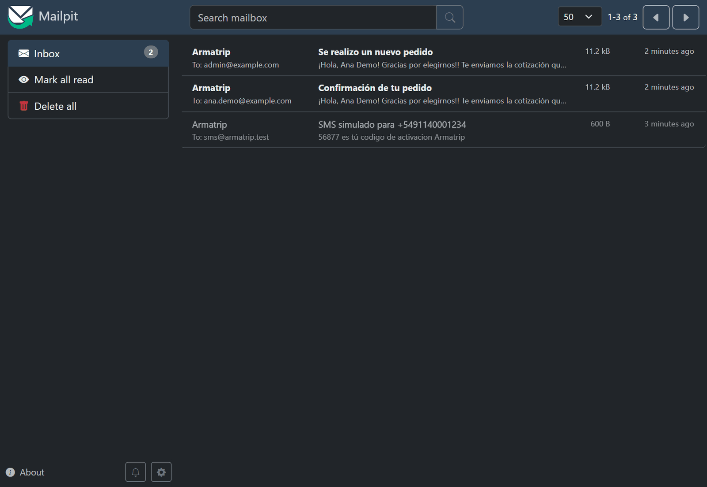</p>

## Configuración

Los secretos viven fuera de git, en `.env`, `backend/.env` y `frontend/.env.local`. El repositorio solo incluye archivos `.env.example` sin claves reales.

| Integración | Variables | Uso |
|---|---|---|
| Mercado Pago | `MP_*` | Seña con tarjeta |
| SMS | `SMS_DRIVER`, `TWILIO_*` | Código de verificación: `mail` en local, `twilio` en producción |
| Email | `MAIL_*` | Avisos al cliente y a la agencia |
| reCAPTCHA | `GOOGLE_RECAPTCHA_SECRET` | Formularios de contacto |
| IMAP | `IMAP_*` | Importación de consultas |

Toda variable `REACT_APP_*` es visible en el navegador: usar solo claves públicas.

## Documentación

| Documento | Contenido |
|---|---|
| [docs/docker.md](docs/docker.md) | Entorno local, comandos y límites conocidos |
| [docs/analysis-backend.md](docs/analysis-backend.md) | API, base de datos, panel e integraciones |
| [docs/analysis-frontend.md](docs/analysis-frontend.md) | Pantallas, estado, rutas y build |
| [docs/marca.md](docs/marca.md) | Logo, colores, tipografías y reglas de uso |
| [AGENTS.md](AGENTS.md) | Convenciones de trabajo y guía para agentes de código |

### Marca

| Lago | Lenga | Retama | Nieve | Noche | Bruma |
|:---:|:---:|:---:|:---:|:---:|:---:|
| `#0A5560` | `#F2542D` | `#FFC247` | `#F3F8F7` | `#0B2530` | `#CFE3E1` |

Tipografías: **Outfit** para títulos y **Figtree** para textos.

## Estado del proyecto

En modernización y **todavía no preparado para producción**.

- [x] Entorno Docker reproducible desde cero
- [x] Identidad de marca aplicada en web, panel y emails
- [x] SMS y emails simulados en desarrollo
- [x] Código de verificación con vencimiento y límite de intentos
- [ ] Refuerzo de autenticación y permisos de la API
- [ ] Actualización de Laravel, PHP, React y dependencias
- [ ] Pruebas automatizadas
- [ ] Migración de estilos en línea a hojas SCSS
